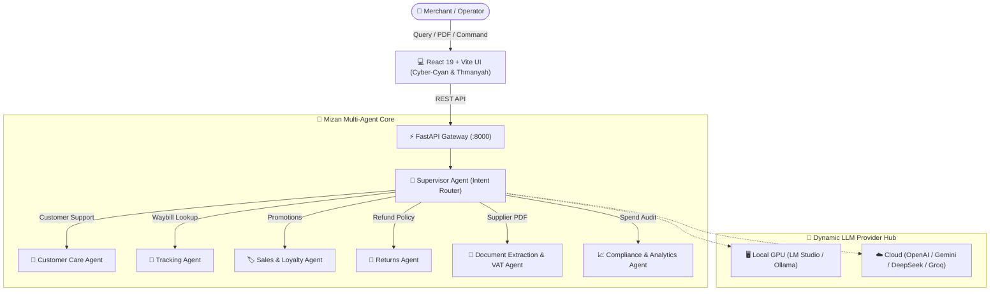
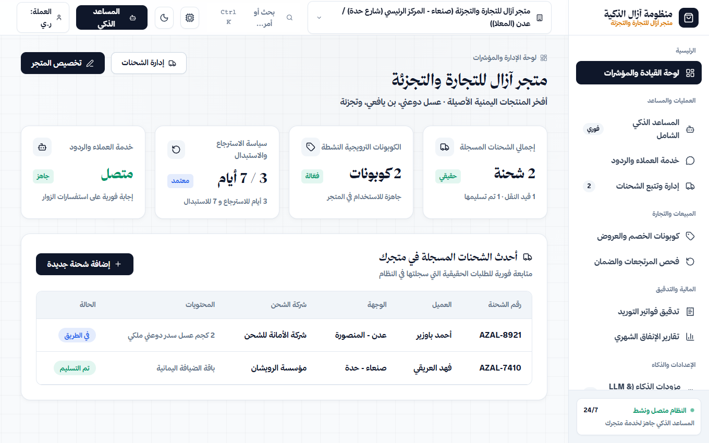
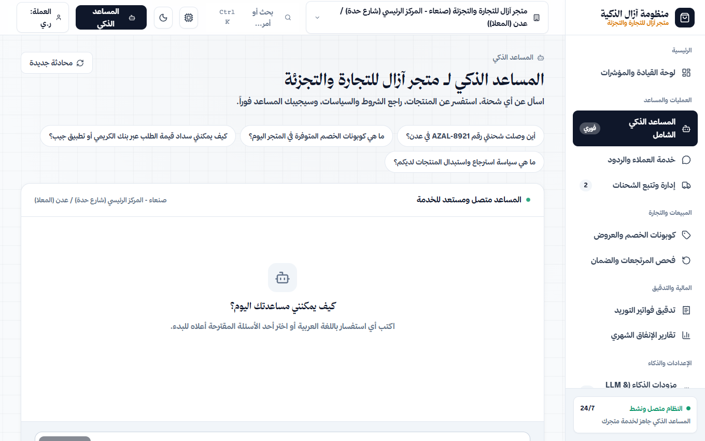
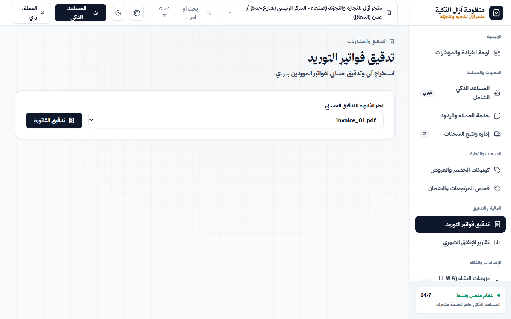
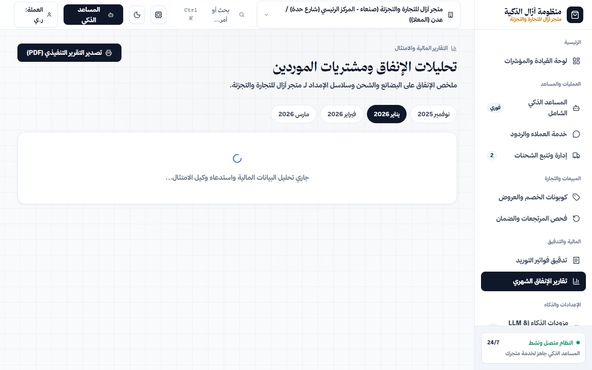

<div align="center">

# ⚖️ Mizan Commerce AI (منظومة ميزان الذكية)

### *Autonomous Multi-Agent AI Operating System for E-Commerce, Invoice Auditing & Financial Compliance*

[](https://github.com/Mo-Alwosabi/Mizan-Commerce-AI)
[](https://github.com/Mo-Alwosabi/Mizan-Commerce-AI)
[](https://github.com/Mo-Alwosabi/Mizan-Commerce-AI)
[](https://github.com/Mo-Alwosabi/Mizan-Commerce-AI)
[](https://github.com/Mo-Alwosabi/Mizan-Commerce-AI)
[](https://github.com/Mo-Alwosabi/Mizan-Commerce-AI)
[](LICENSE)

**[ 🇸🇦 الدليل باللغة العربية ](README.ar.md)** &nbsp;|&nbsp; **[ 🏗️ Architecture ](#-multi-agent-architecture)** &nbsp;|&nbsp; **[ 🚀 Quick Start ](#-quick-start)** &nbsp;|&nbsp; **[ 👨‍💻 Author ](#-author--contact)**

*Engineered by **[Mohammed Alwosabi](https://github.com/Mo-Alwosabi)** — AI & Machine Learning Systems Engineer*

</div>

---

## 🎯 Overview

**Mizan Commerce AI (منظومة ميزان الذكية)** is a production-grade, multi-agent AI operating system engineered for modern e-commerce brands, logistics operations, and financial compliance teams. It combines a deterministic **Supervisor Routing Engine**, **100% offline local GPU inference** (LM Studio & Ollama) alongside **9 dynamic cloud LLM providers**, automated **PDF supplier invoice auditing**, and localized Arabic RTL customer-care workflows.

---

## 🌟 Key Engineering Highlights

- **🧠 Supervisor Multi-Agent Orchestration**: Intent-routing engine coordinating specialized agents for Customer Care, Order Tracking, Returns & Refunds, Document Extraction, and Financial Compliance.
- **🔒 100% Offline Sovereign GPU Inference**: Native support for **LM Studio** and **Ollama** (`gemma-4`, `llama-3.3-70b`, `qwen-2.5`) on local NVIDIA RTX CUDA hardware with zero recurring API costs.
- **🔌 Dynamic 9-Provider LLM Hub**: Hot-swap between LM Studio, Ollama, OpenAI, Google Gemini, DeepSeek, Groq Cloud, OpenRouter, Mistral AI, or any OpenAI-compatible endpoint directly from the UI.
- **🧾 Autonomous Invoice & VAT Auditing**: Extracts structured line-items from supplier PDFs, verifies arithmetic and VAT accuracy (`validate_vat.py`), and flags discrepancies automatically.
- **📊 Executive Financial Analytics**: Aggregates vendor spend, computes month-over-month deltas, and generates executive Arabic compliance summaries.
- **🎨 Cyber-Cyan & Deep Indigo RTL UI**: Built with React 19, TypeScript, and Vite featuring dual OLED Dark & Light themes and native **Thmanyah** Arabic typography.

---

## 🏗️ Multi-Agent Architecture



---

## 🖥️ UI & Experience Showcase

<div align="center">

| Executive Dashboard | AI Copilot & Multi-Agent Routing |
| :---: | :---: |
|  |  |

| Autonomous Invoice Extraction | Financial Compliance Report |
| :---: | :---: |
|  |  |

</div>

---

## 📁 Project Structure

```text
Mizan-Commerce-AI/
├── agents/                 # Supervisor, Customer, Document, Compliance & VAT validators
├── api/                    # FastAPI gateway & dynamic 9-provider LLM manager
├── config/                 # LLM provider & store configuration JSON
├── data/                   # Product catalog, FAQs, and sample supplier PDF invoices
├── evals/                  # Safety & accuracy evaluation datasets and test runners
├── storage/                # Extracted invoice JSON store & financial aggregators
├── web/                    # React 19 + TypeScript + Vite RTL frontend (Thmanyah Font)
├── docker-compose.yml      # Full-stack container orchestration
├── pyproject.toml          # Python package configuration
└── README.md               # Documentation
```

---

## 🚀 Quick Start

### 1. Clone Repository
```bash
git clone https://github.com/Mo-Alwosabi/Mizan-Commerce-AI.git
cd Mizan-Commerce-AI
```

### 2. Backend Setup (FastAPI)
```bash
python -m venv .venv
.venv\Scriptsctivate
pip install -r requirements.txt
copy .env.example .env
uvicorn api.main:app --reload --port 8000
```

### 3. Frontend Setup (React 19 + Vite)
```bash
cd web
npm install
npm run dev
```

Open `http://localhost:5173` in your browser.

---

## 👨‍💻 Author & Contact

**Mohammed Alwosabi** — *AI & Machine Learning Systems Engineer*  
Specializing in Multi-Agent Systems, Advanced RAG, and Sovereign Local AI Inference.

- 🐙 **GitHub:** [@Mo-Alwosabi](https://github.com/Mo-Alwosabi)
- 💼 **LinkedIn:** [Mohammed Alwosabi](https://www.linkedin.com/in/mohammed-al-wosabi-609a693a1)
- 📧 **Email:** `ai.mohammed.alwosabi@gmail.com`
- 📍 **Location:** Sana'a, Yemen
